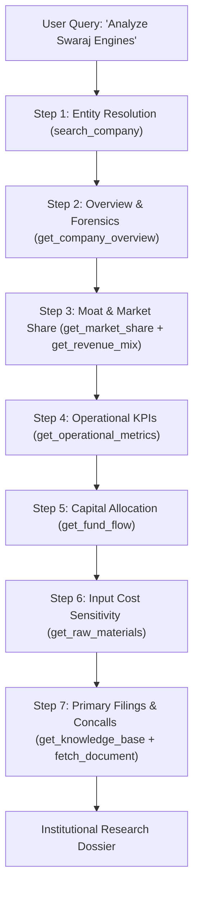

# Tijori Research Skill

This skill guides AI agents in conducting rigorous fundamental due diligence and business breakdown on Indian equities using the **Tijori Finance MCP Server**.

---

## 1. Core Workflow & Call Sequencing

Always execute research in structured sequential phases to ensure full ground-truth synchronization:

---

## 2. Step-by-Step Execution Guide

### Step 1: Entity Resolution & Slug Discovery
**Tool**: `search_company(query)`
- **Rule**: Never guess slugs. Indian company slugs often have specific legal suffixes (e.g., `swaraj-engines-limited`, `tata-steel-limited`).
- **Action**: Pass the ticker or company name to `search_company`. Extract the authoritative `slug`.
- If numeric operations like `get_fund_flow` are required, immediately follow with `resolve_company_ids(slug)`.

### Step 2: Corporate Overview & Forensic Quality Audit
**Tool**: `get_company_overview(slug)`
- **Extract**:
  - Current Market Cap, Stock P/E, Median P/E, Book Value, ROE, ROCE.
  - **17-Point Forensic Checklist**: Review the distribution of `Yes` (healthy), `Neutral`, and `No` (governance red flags). Highlight any critical flags such as auditor resignations, high promoter pledging, or irregular receivables growth.

### Step 3: Moat Analysis: Market Share & Revenue Mix
**Tools**: `get_market_share(slug)` & `get_revenue_mix(slug, type="product")`
- **Examine**:
  - **Market Share %**: Is the company gaining, maintaining, or losing share in its core segment over time? Note the exact as-of date.
  - **Product Revenue Mix**: How has the product basket evolved over the past 5–10 years? Identify whether high-margin or premium product lines are expanding as a percentage of total revenue.
  - **Geographic Mix (`type="location"`)**: Assess export exposure vs. domestic Indian market dependency.

### Step 4: Deep Operational KPIs & Unit Economics
**Tool**: `get_operational_metrics(slug)`
- This is Tijori's core institutional advantage. Extract sector-specific quantitative time series:
  - **Auto & Tractors**: Engine/vehicle volumes produced, sales volume, plant capacity utilization %, realization per unit.
  - **Healthcare**: ARPOB (Average Revenue Per Occupied Bed), bed occupancy %, average length of stay.
  - **Capital Goods & Infrastructure**: Order book size, execution run-rate, book-to-bill ratio.
  - **Cement / Metals**: EBITDA per tonne, volume sold (MTPA), capacity utilization.
  - **Airlines & Hospitality**: Passenger load factor (PLF), RevPAR, available seat kilometers (ASK).

### Step 5: Capital Allocation & Fund Flow Forensics
**Tools**: `resolve_company_ids(slug)` → `get_fund_flow(company_id, period="10")`
- **Evaluate**: Over a 5-year and 10-year period, how did management allocate cash?
  - What percentage of operating cash flow was reinvested into Organic CapEx?
  - How much went towards debt reduction vs. shareholder returns (dividends & buybacks)?
  - Were there large unallocated treasury investments or aggressive debt-fueled acquisitions?

### Step 6: Input Cost & Raw Material Sensitivity
**Tool**: `get_raw_materials(commodity)`
- Identify the key input commodities that drive the company's cost of materials consumed.
- Check 3–5 year price trends for critical inputs (e.g. Brent crude, pig iron, aluminium, polypropylene) to model gross margin expansion or compression.

### Step 7: Primary Source Grounding & Concall Extraction
**Tools**: `get_knowledge_base(slug)` → `fetch_document(url)`
- Query `get_knowledge_base` to retrieve verified links to:
  - Latest Earnings Call Transcripts (Concalls)
  - Latest Investor Presentations
  - Latest Annual Reports
- Call `fetch_document(url)` on the latest concall transcript to extract direct management guidance, CapEx roadmaps, and competitive dynamics.

---

## 3. Mandatory Guardrails & Reporting Standards

1. **Strict Citation Rigor**: Whenever quoting market share percentages, production capacity, or operational volumes, include the specific year and source metadata returned by Tijori.
2. **Explicit Data Separation**: Always clarify whether numbers represent standalone parent operations or consolidated group entities.
3. **Session Expiry Handling**: If a tool returns `SESSION_EXPIRED`, immediately alert the operator to execute `npm run reauth` in the terminal to refresh session cookies.
