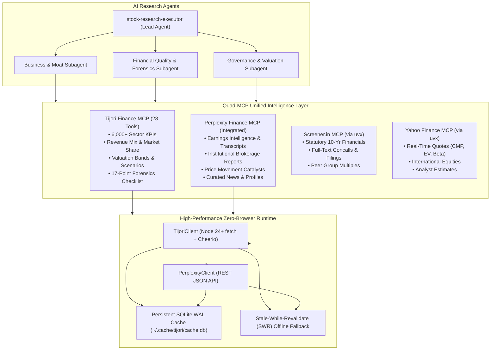

# AGENTS.md — finance-ai: Quad-MCP Equity Research Engine

Operational guidelines, architectural standards, and data taxonomy for AI agents (Antigravity, Claude Code, Cursor, OpenCode) developing and consuming the **finance-ai** repository (`https://github.com/varunpalekar/finance-ai`).

---

## 1. Project Purpose & Executive Rationale

### Why We Are Creating This Platform
In institutional Indian and global equity research, fundamental models frequently suffer from the **"Statutory Bias Fallacy"**:
- Traditional sources like **Screener.in** excel at reported statutory financial statements (P&L, Balance Sheet, Cash Flows, basic ratios, quarterly filings).
- Global platforms like **Yahoo Finance** excel at real-time market quotes, market cap, beta, and consensus analyst targets.
- **The Critical Missing Layer**: Neither platform captures the **micro-operational mechanics, competitive moats, unit economics, and real-time earnings sentiment** that drive fundamental business value.

**finance-ai** bridges this gap by unifying four complementary intelligence layers into a coherent **Quad-MCP Architecture**:
1. **Tijori Finance MCP**: Granular non-statutory operational intelligence, 6,000+ sector-specific KPIs, multi-year product and geographic revenue mix, market share dynamics, capital allocation fund flows, forensic accounting checks, and statistical P/E valuation percentile bands across 5,000+ NSE/BSE listed companies.
2. **Perplexity Finance Intelligence**: Institutional brokerage reports, consensus earnings surprises, AI highlights, diarized concall transcripts, executive milestone catalysts, and real-time publisher news.
3. **Screener.in MCP**: Statutory 10-year financials, balance sheets, peer group comparisons, corporate announcements, and deep full-text concall / PDF research (`ask_company_research`).
4. **Yahoo Finance MCP**: Global real-time market data, CMP, Beta, 52-week High/Low, Enterprise Value, and international market coverage.
5. **Agent Browser**: Headless / interactive browser automation for live filing extraction, exchange announcements, and verification.



---

## 2. In-Depth Information Taxonomy

The platform exposes 28 distinct tools categorized into 8 research domains:

### Domain 1: Entity Resolution & Corporate Metadata
- **Tools**:
  - `search_company(query)`: Resolves company names/symbols to standardized URL slugs.
  - `resolve_company_ids(slug)`: Resolves slug to numeric `company_id` for backend fund flow routes.
  - `get_user_info()`: Subscription tier and session validation status.
  - `clear_cache(slug?)`: Cache maintenance and invalidation.

### Domain 2: Forensic Accounting & Return Profile
- **Tools**:
  - `get_company_overview(slug)`: Core multiples (PE, PB, EV/EBITDA), return profile (ROE, ROCE 3/5-year averages), and the 17-point forensic checklist (auditor changes, promoter pledging, debt stress).
  - `get_factors_and_benchmarking(slug)`: Factor scores (Valuation, Quality, Growth) with percentile rankings.

### Domain 3: Multi-Cycle Financial Statements & Capital Allocation
- **Tools**:
  - `get_financials(slug, type, basis)`: 10-year annual and 10-quarter statutory statements (PL, BS, Cash Flow, Ratios) with consolidated/standalone selector.
  - `get_shareholding(slug, detailed)`: 10-quarter ownership trends across Promoter, FII, DII, and Public tiers; `detailed: true` exposes domestic mutual funds and retail brackets.
  - `get_fund_flow(company_id, years)`: Cumulative Sources vs. Uses of Cash over 1, 3, 5, 7, or 10-year windows.
  - `get_corporate_actions(slug)`: Historical dividends, bonus issues, stock splits, and rights offerings.

### Domain 4: Micro-Operational KPIs & Competitive Moats
- **Tools**:
  - `get_operational_metrics(slug)`: Complete time series of 6,000+ sector-specific unit KPIs (capacity, production volumes, realizations, ARPOB, PLF).
  - `get_revenue_mix(slug, type)`: Multi-year percentage distribution across product categories or geographic markets.
  - `get_market_share(slug)`: Micro-segment market share percentage and competitor peer comparisons.
  - `get_supply_chain(slug)`: Product relationships, supplier dependencies, customer concentration.

### Domain 5: Valuation Bands & Scenario Projections
- **Tools**:
  - `get_valuation_bands(slug)`: Statistical 1Y, 3Y, 5Y, and 10Y P/E percentile bands (min, p25, median, p75, max).
  - `get_scenario_projections(slug)`: Forward-looking Base, Bear, and Bull probabilistic scenarios with odds, triggers, and 5-year forecast models.

### Domain 6: Macro Indicators, Raw Materials & Market Themes
- **Tools**:
  - `get_raw_materials(tab)`: Commodity price tracking for chemicals, metals, and petrochemical spreads.
  - `get_macro_indicators(tab)`: Macroeconomic benchmark indicators (credit growth, IIP, GST collections, inflation).
  - `get_markets(tab)`: Performance across headline indices, niche thematic indices, and Indian conglomerate baskets.
  - `get_sector_constituents(tjiid)`: Constituent companies of thematic niche indices (e.g., EMS, Defence).
  - `get_conglomerate_constituents(tjiid)`: Group company listings (e.g., Tata, Birla, Adani, Mahindra).

### Domain 7: Primary Knowledge Base & Full-Text Filings
- **Tools**:
  - `get_knowledge_base(slug)`: Categorized catalog of Annual Reports, Investor Presentations, and Concall Transcripts.
  - `fetch_document(url)`: Full-text extraction from investor PDFs directly into agent context.
  - `get_company_timeline(slug)`: Chronological milestones timeline and analyst "What to watch" monitorables.
  - `get_stock_news(query, limit, days)`: Google News RSS aggregator for real-time financial press coverage.

### Domain 8: Perplexity Finance Intelligence
- **Tools**:
  - `get_earnings_intelligence(ticker/slug)`: Consensus revenue/EPS surprises, AI highlights, and diarized concall transcripts.
  - `get_brokerage_reports(ticker/slug)`: Institutional research reports with outlooks (bullish/neutral/bearish) and PDF downloads.
  - `get_price_movement_catalysts(ticker/slug)`: Historical price catalysts, causal explanations, and source links.
  - `get_company_strategic_profile(ticker/slug)`: Corporate profile, valuation multiples, and strategic positioning.
  - `get_curated_news(ticker/slug)`: Curated financial media commentary and sentiment.

---

## 3. Skills & Agent Plugins Directory

### 3.1 Project-Scoped Plugins
- `.agents/plugins/stock-research/`:
  - `mcp_config.json`: Production Quad-MCP configuration launching `screener`, `yfinance`, `agent-browser`, and `tijori-finance` via `npx -y -s github:varunpalekar/finance-ai#main`.
  - `mcp_config.example.json`: Sample template for custom credentials and session paths.
  - `plugin.json`: Namespaces the plugin for Antigravity.
- `.agents/plugins/tijori-finance/`:
  - `mcp_config.json`: Local development configuration executing `src/index.js` directly.
  - `plugin.json`: Plugin registration.

### 3.2 Agent Research Skills
- `.agents/skills/stock-research-executor/`:
  - The flagship 8-phase institutional due diligence skill for AI agents.
  - Enforces fail-closed evidence validation, currency and scale normalization, timestamp grounding, and strict separation of consensus estimates from actuals.
- `.agents/skills/tijori-research/`:
  - Targeted operational deep dive skill for Indian equities.
- `.agents/skills/agent-browser/`:
  - Browser automation skill for interactive filing verification.

---

## 4. Authentication, Session Governance & Security

### 🔒 Security Mandates
- **Zero Secrets in Code**: Never commit `.env` files, passwords, or personal filesystem paths to git.
- **Secure File Storage**: Authentication cookies are stored locally in `output/session.json` and `output/perplexity_session.json` with `0o600` permissions.
- **Dynamic Reloading**: Runtime clients automatically reload updated session files without restarting the MCP server process.

### Session Lifecycle Commands
```bash
# Authenticate Tijori Finance (headed browser login)
npm run auth

# Re-authenticate Tijori Finance
npm run reauth

# Authenticate Perplexity Finance
npm run auth:pplx

# Re-authenticate Perplexity Finance
npm run reauth:pplx

# Perplexity session health check
npm run status:pplx
```

---

## 5. Development, Testing & Verification Protocols

### Verification Commands
```bash
# Verify dependencies
npm install

# Run the 114 offline hermetic unit & parser tests
npm test

# Run live Tijori integration suite (requires active Tijori session)
npm run test:live

# Run live Perplexity integration suite (requires active Perplexity session)
npm run test:pplx

# Launch MCP server via stdio
npm start
```

### Benchmark Universe for Regression
Every change to parsers in `src/parsers/` or tools in `src/client/` must pass verification against two diverse benchmark companies:
1. **Manufacturing / Capital Goods Benchmark**: `swaraj-engines-limited` (verifies single-segment engine volume, capacity utilization %, related-party disclosures).
2. **Multi-Segment Global Conglomerate Benchmark**: `tata-steel-limited` (verifies multi-geography revenue mix, crude/iron ore raw material links, debt schedules).

---

## 6. Implementation & Governance Standards

- **Feature Ledger (`docs/features.md`)**: Update for every requirement or behavioral modification.
- **Architectural Decision Records (`docs/decisions/`)**: Record structural choices as ADRs (`docs/decisions/NNNN-short-title.md`).
- **Learning Ledger (`docs/learning/`)**: Document empirical findings and bug postmortems in sequential logs (`docs/learning/NNN-short-title.md`).
- **Environments & Testing (`docs/environments-and-testing.md`)**: Track test suite status and environment requirements.
