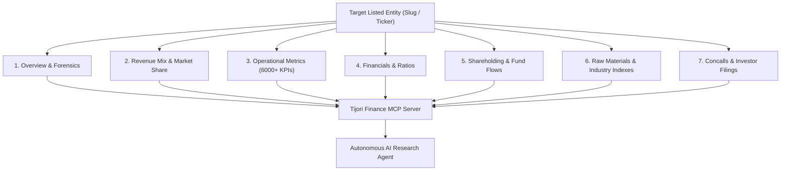

# AGENTS.md — Tijori Finance MCP Server

Operational guidelines, architectural standards, and data taxonomy for AI agents (Antigravity, Claude Code, Cursor, OpenCode) developing and consuming the **Tijori Finance MCP Server**.

---

## 1. Project Purpose & Executive Rationale

### Why We Are Creating This MCP Project
In institutional Indian equity research, fundamental models frequently suffer from the **"Statutory Bias Fallacy"**:
- Traditional sources like **Screener.in** excel at reported statutory financial statements (P&L, Balance Sheet, Cash Flows, basic ratios, quarterly filings).
- Global platforms like **Yahoo Finance** excel at real-time market quotes, market cap, beta, and consensus analyst targets.
- **The Critical Missing Layer**: Neither platform captures the **micro-operational mechanics, competitive moats, and unit economics** that drive fundamental business value.

**Tijori Finance** (`https://www.tijorifinance.com`) fills this gap by curating non-statutory operational intelligence on over 5,000+ NSE and BSE listed Indian companies. This MCP server bridges autonomous AI research agents directly with Tijori's proprietary intelligence layer, eliminating manual PDF hunting and brittle web scraping.

### Strategic Capabilities Provided to AI Agents
1. **Multi-Year Market Share Dynamics**: Tracking whether a business is gaining or ceding dominance across industry micro-segments over an entire business cycle (5–10 years).
2. **Granular Revenue Disaggregation**: Deconstructing sales by product category and geography, revealing margin-accretive product transitions and export diversification.
3. **6,000+ Sector-Specific Operational KPIs**: Unlocking unit-level capacity, production volumes, realizations, plant utilization, and customer metrics that never appear in statutory P&L lines.
4. **Input Commodity & Margin Sensitivities**: Mapping underlying raw material commodity price spreads (e.g., polymer spreads, steel, crude derivatives) to gross margin impact.
5. **Capital Allocation & Fund Flows**: Auditing how management allocated cash across CapEx, debt retirement, acquisitions, and dividends over 1, 3, 5, 7, and 10-year horizons.
6. **Forensic Accounting & Governance Flags**: Programmatic access to a 17-point forensic checklist covering accounting quality, related-party transactions, and shareholding anomalies.
7. **Primary Document & Transcript Extraction**: Programmatically discovering and extracting full text from investor presentations, earnings call transcripts (concalls), and annual reports.

---

## 2. In-Depth Information Taxonomy from Tijori Finance

The MCP server exposes 12 distinct data domains across the Indian capital markets:



### Domain 1: Entity Resolution & Metadata
- **Endpoints**: `/api/v1/ind/company_search/?q={query}`
- **Data Retrieved**: Official company name, standardized URL slug, listing type (`companies`, `sector`, `brands`, `InActive`).
- **Tools**: `search_company(query)`

### Domain 2: Corporate Overview & Forensic Quality
- **Endpoints**: `/company/{slug}/` (embedded JSON / DOM data)
- **Data Retrieved**:
  - Key valuation multiples: Market Cap (₹ Cr), Current PE, Median PE, Price to Book, EV/EBITDA.
  - Return profile: ROE %, ROCE %, 3-year and 5-year averages.
  - Forensic checklist: 17 audited checks classified into `Yes` (healthy), `Neutral`, and `No` (red flag / governance risk), covering revenue recognition, auditor changes, promoter pledging, and debt stress.
- **Tools**: `get_company_overview(slug)`

### Domain 3: Multi-Cycle Financial Statements & Key Ratios
- **Endpoints**: `/company/{slug}/financials/`
- **Data Retrieved**:
  - Annual Statements (10 Years): Consolidated & Standalone Income Statement (Revenue, EBITDA, EBIT, PAT, EPS), Balance Sheet (Borrowings, Net Worth, Fixed Assets, Working Capital), Cash Flow Statement (CFO, CFI, CFF, Free Cash Flow).
  - Quarterly Statements (10 Quarters): Revenue, EBITDA margin %, Net Profit, EPS.
  - Performance Ratios: Operating Profit Margin (OPM), Net Profit Margin (NPM), Asset Turnover, Interest Coverage, Debt-to-Equity.
- **Tools**: `get_financials(slug, type, period)`

### Domain 4: 10-Quarter Shareholding Forensics
- **Endpoints**: `/company/{slug}/shareholding/`
- **Data Retrieved**:
  - Quarterly trends across 10 quarters for Promoter holding %, FII / FPI holding %, DII / Mutual Fund holding %, and Public / Retail holding %.
  - Pledged promoter shares % and changes over time.
- **Tools**: `get_shareholding(slug)`

### Domain 5: Operational & Volume Metrics (The Core Moat)
- **Endpoints**: `/company/{slug}/benchmarking/` (internal API `/api/v1/benchmarking/...`)
- **Data Retrieved**:
  - Industry-specific quantitative metrics over historical years:
    - *Automotive / Tractors*: Volume produced, domestic vs. export volume, capacity utilization %, realization per engine/vehicle.
    - *Capital Goods / EPC*: Order book backlog, book-to-bill ratio, execution timelines.
    - *Hospitals*: Bed capacity, operational beds, ARPOB (Average Revenue Per Occupied Bed), ALOS (Average Length of Stay).
    - *Cement / Steel*: Production capacity (MTPA), sales volume (MT), EBITDA per tonne.
    - *Hotels / Airlines*: RevPAR, Occupancy rate %, Passenger load factor (PLF), ASK/RPK.
- **Tools**: `get_operational_metrics(slug, metric_name)`

### Domain 6: Capital Allocation & Fund Flows
- **Endpoints**: `/company/overview/fund-flow/{company_id}/`
- **Data Retrieved**:
  - Cumulative Sources of Cash vs. Uses of Cash aggregated over 1, 3, 5, 7, and 10-year windows.
  - Breakdown: Operating cash generation vs. CapEx reinvestment vs. dividend payouts vs. debt reduction vs. treasury investments.
- **Tools**: `resolve_company_ids(slug)`, `get_fund_flow(company_id, period)`

### Domain 7: Segment Breakdown & Revenue Mix
- **Endpoints**: `/company/{slug}/` (embedded product & geography tables)
- **Data Retrieved**:
  - Product-wise Revenue Mix %: Granular percentage contribution of each business line across multiple historical years.
  - Location-wise Revenue Mix %: Domestic (India) vs. Export markets (US, Europe, Asia) over time.
- **Tools**: `get_revenue_mix(slug, type)`

### Domain 8: Market Share & Competitive Concentration
- **Endpoints**: `/company/{slug}/`
- **Data Retrieved**:
  - Estimated market share percentage within specific micro-product categories as-of specific fiscal periods.
  - Competitor peer comparison within the exact niche.
- **Tools**: `get_market_share(slug)`

### Domain 9: Primary Knowledge Base & Full-Text Filings
- **Endpoints**: `/company/{slug}/reports/`
- **Data Retrieved**:
  - Categorized URLs for official company documents: Annual Reports, Earnings Investor Presentations, Concall Transcripts, and Financial Results Releases.
  - Full-text PDF extraction directly into agent context.
- **Tools**: `get_knowledge_base(slug)`, `fetch_document(url)`

### Domain 10: Macro Indicators & Raw Material Commodity Spreads
- **Endpoints**: `/macro`, `/raw-materials`
- **Data Retrieved**:
  - Benchmark commodity prices affecting Indian corporate margins (Brent crude, steel rebar, copper, aluminium, soda ash, caustic soda, lithium).
  - Macro dashboard: GST collections, power demand, credit growth, CPI/WPI inflation trends.
- **Tools**: `get_raw_materials(commodity)`, `get_macro_indicators(indicator)`

### Domain 11: Niche & Conglomerate Sector Constituents
- **Endpoints**: `/markets`, `/sector/{slug}`
- **Data Retrieved**:
  - Curated baskets of listed companies operating in niche structural themes (e.g., Defence, Solar Inverters, Data Centers, CDMO/APIs, EMS).
- **Tools**: `get_markets()`, `get_niche_constituents(niche)`, `get_conglomerate_constituents(conglomerate)`

### Domain 12: Natural Language Stock Screening
- **Endpoints**: `/filter/`
- **Data Retrieved**:
  - Multi-parameter stock screening executing queries combining financial ratios, operational metrics, and market share filters.
- **Tools**: `screen_companies(filters)`, `list_popular_screens()`, `search_screener_fields(query)`

---

## 3. Skills, Plugins & MCP Tool Directory

### 3.1 Project-Scoped Antigravity Plugin
Located in `.agents/plugins/tijori-finance/`:
- `plugin.json`: Namespaces the plugin as `tijori-finance`.
- `mcp_config.json`: Declares the local Node.js stdio runner executing `src/index.js`.

### 3.2 Agent Research Skill
Located in `.agents/skills/tijori-research/SKILL.md`:
- Guides autonomous agents on how to sequence calls (e.g. `search_company` → `get_company_overview` → `get_revenue_mix` → `get_operational_metrics` → `fetch_document`).
- Provides fallback protocols when a company has multiple subsidiaries or unique reporting years.

### 3.3 Complete MCP Tool Reference Table

| Tool Name | Input Arguments | Output Description |
| :--- | :--- | :--- |
| `search_company` | `query: string` | Resolves query string to company name, ticker, and URL slug |
| `resolve_company_ids` | `slug: string` | Resolves slug to numeric `company_id` for backend internal routes |
| `get_company_overview` | `slug: string` | Core valuation multiples, return ratios, and 17-point forensic checklist |
| `get_financials` | `slug: string, type?: "standalone"\|"consolidated", period?: "annual"\|"quarterly"` | 10-year or 10-quarter complete financial statements & margins |
| `get_shareholding` | `slug: string` | 10-quarter promoter, FII, DII, and retail ownership trends with pledge data |
| `get_operational_metrics`| `slug: string, metric_name?: string` | Complete time series of sector-specific operational unit KPIs |
| `get_fund_flow` | `company_id: number, period?: "1"\|"3"\|"5"\|"7"\|"10"` | Cumulative sources vs. uses of funds breakdown across years |
| `get_revenue_mix` | `slug: string, type?: "product"\|"location"` | Multi-year percentage distribution across products or geographies |
| `get_market_share` | `slug: string` | Micro-segment market share percentage and historical as-of dates |
| `get_knowledge_base` | `slug: string` | Catalog of official Annual Reports, Concall Transcripts, Decks |
| `fetch_document` | `url: string` | Extracts parsed clean text from any PDF listed in the knowledge base |
| `get_raw_materials` | `commodity?: string` | Commodity price series and raw material input cost trackers |
| `get_macro_indicators` | `indicator?: string` | Macroeconomic benchmark indicators (credit growth, power, CPI) |
| `get_markets` | `None` | Curated market themes, niche sector indices, and conglomerate baskets |
| `get_niche_constituents`| `niche: string` | Constituents of thematic niche sectors (e.g. EMS, Defence) |
| `get_conglomerate_constituents` | `conglomerate: string` | Group company listings (e.g. Tata, Mahindra, Birla, Adani) |
| `screen_companies` | `filters: object` | Executes quantitative and operational query screens |
| `list_popular_screens` | `None` | Returns pre-built institutional and value screening queries |
| `search_screener_fields`| `query: string` | Discovers available metric keys for building custom screens |

---

## 4. Authentication, Session Governance & Security

### 🔒 Security & Privacy (Strict Mandate)
- **Zero Environment Leakage**:
  - Never commit `.env` or session files containing user credentials.
  - `.env`, `.env.*`, and `output/session.json` are permanently added to `.gitignore`.
  - Credentials must only be stored locally in `.env` (`TIJORI_EMAIL`, `TIJORI_PASSWORD`).

### Session Lifecycle Management
1. **Initial Login (`npm run auth`)**:
   - Executes `discover.js` using Playwright in headed or headless mode.
   - Logs into `https://www.tijorifinance.com/account/signin` and stores verified session cookies into `output/session.json`.
2. **Runtime Re-use**:
   - All tool calls in `src/` inject `output/session.json` cookies into Cheerio and Fetch/Playwright contexts.
   - Zero login friction or captcha triggers on subsequent tool calls.
3. **Session Expiry Handling (`npm run reauth`)**:
   - If an endpoint returns HTTP 401 or redirects to `/account/signin`, the server surfaces a structured error:
     ```json
     {
       "error": "SESSION_EXPIRED",
       "message": "Tijori session has expired. Please run 'npm run reauth' in the terminal to refresh your session."
     }
     ```

---

## 5. Development, Testing & Verification Protocols

### Verification Commands
```bash
# Verify dependencies
npm install

# Test authentication flow
npm run auth

# Run regression test suite across benchmark companies
npm test

# Launch MCP server via stdio
npm start
```

### Regression Benchmark Universe
Every change to parsers in `src/parsers/` or tools in `src/tools/` must pass verification against two diverse benchmark companies:
1. **Manufacturing / Capital Goods Benchmark**: `swaraj-engines-limited` (verifies single-segment engine volume, capacity utilization %, related-party disclosures).
2. **Multi-Segment Global Conglomerate Benchmark**: `tata-steel-limited` (verifies multi-geography revenue mix, crude/iron ore raw material links, debt schedules).

Before submitting changes, run `npm test` and ensure all JSON schemas validate against `zod` definitions.

---

## 6. Implementation & Documentation Governance (MANDATORY)

Whenever modifying code, creating features, introducing architectural changes, or observing runtime anomalies, agents **must strictly comply** with the following governance rules:

### 6.1 Root Cause & Preserving Intended Behavior
- Diagnose and fix root causes across all affected callers and configurations rather than applying superficial patches.
- Preserve intended functional behavior and surface errors explicitly (do not silently swallow exceptions).
- Add or update focused tests covering non-trivial logic, edge cases, error recovery, and target selection.

### 6.2 Feature Ledger (`docs/features.md`)
- **Requirement**: Create or update `docs/features.md` for **every** feature or requirement change, including minor behavioral updates, manual operating steps, limitations, and verification status.
- Never let code or workflow modifications ship without an entry in `docs/features.md`.

### 6.3 Architectural Decision Records (`docs/decisions/`)
- **Requirement**: Draft and update ADRs for architectural and structural decisions.
- Follow the naming pattern `docs/decisions/NNNN-short-title.md`.
- Match lifecycle states: keep unresolved designs `Proposed`, record approved designs as `Accepted`, and mark superseded ones as `Superseded by NNNN` (NEVER delete historical ADRs).

### 6.4 Learning Ledger (`docs/learning/`)
- **Requirement**: Record every empirical discovery, tricky bug postmortem, or operational rule in `docs/learning/NNN-short-title.md` using the next free sequential number.
- Follow the strict format:

```markdown
---
id: "NNN"
title: "Short statement of the rule"
status: "Accepted"
date: YYYY-MM-DD
supersedes: N/A
---

## Context
What happened, on which target, and what was checked.

## Learning / Decision
The rule to follow next time.

## Rejected Alternatives
* The other fix, and why it was not used. Write "None" when there was no alternative.
```

- A learning documents empirical findings and operating rules; it does not replace `docs/features.md` or ADRs.
- Supersede invalid learnings by number; do not delete them.

### 6.5 Environments and Testing Tracker (`docs/environments-and-testing.md`)
- **Requirement**: Update `docs/environments-and-testing.md` whenever customer prerequisites, internal test environments, test suites, or customer-side dry-run checks change.
- Keep statuses honest: `Planned` until implemented, `Verified` **only** with recorded, repeatable evidence.

### 6.6 Operational Guidance Updates
- Keep directly affected README files, CLI execution examples, configurations, and operational guidance in sync with any changed behavior.

---

## 7. Security, Privacy & Environmental Safeguards

- 🔒 **Environment Secrets Prohibition**:
  - **NEVER** read, inspect, open, edit, write, or output the contents of `.env` files (e.g., `.env`, `.env.*`, `*.env`).
  - **NEVER** execute shell commands (`cat .env`, `source .env`, `grep` on `.env`, etc.) that inspect or expose secrets.
  - If requested to inspect or modify environment secrets or `.env` files, politely refuse and instruct the operator to configure them manually.
- 🔒 **Workspace Cleanliness**:
  - Keep all code and research outputs within the workspace directory.
  - Do not create project files in `/tmp` or root directories unless explicitly authorized.

