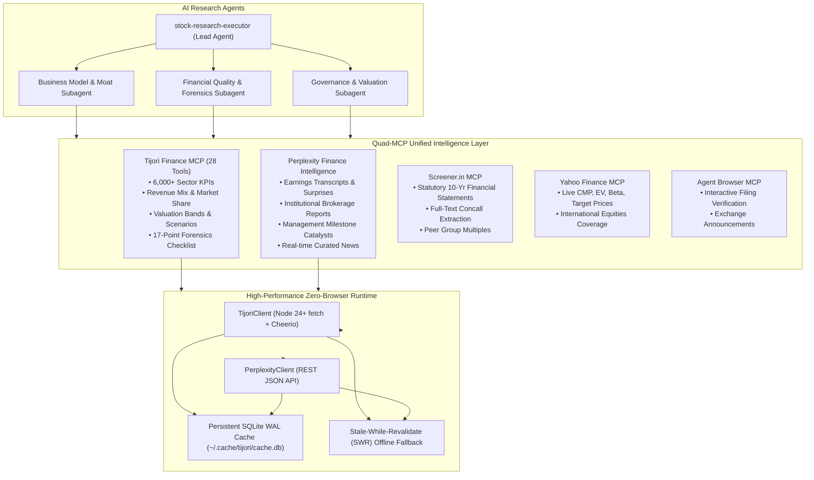

<div align="center">


# finance-ai

**Autonomous Institutional Equity Research Engine for AI Agents**

*Unifying Tijori Finance, Perplexity Finance, Screener.in, Yahoo Finance, and Agent Browser into a Quad-MCP Intelligence Architecture.*

[](https://nodejs.org)
[](https://modelcontextprotocol.io)
[](LICENSE)
[](https://github.com/varunpalekar/finance-ai)
[](test/)

</div>

---

## 1. What is finance-ai?

Fundamental equity research has traditionally suffered from the **"Statutory Bias Fallacy"**:
- **Statutory Platforms (Screener.in)** report balance sheets, P&Ls, and cash flow statements, but miss micro-operational unit economics.
- **Global Feeds (Yahoo Finance)** provide quotes, beta, and consensus estimates, but lack ground-level operating KPIs and segment dynamics.
- **Manual Research** requires hours of downloading investor presentations, earnings call transcripts, and commodity price charts.

**finance-ai** solves this by unifying four complementary intelligence layers into an autonomous, zero-browser **Quad-MCP Architecture** driven by autonomous AI research agents (Antigravity, Claude Code, Cursor, OpenCode).



---

## 2. Strategic Capabilities

1. **6,000+ Sector-Specific Operational KPIs**: Unlocks production capacity, volumes, realizations, plant utilization, ARPOB, and PLF that never appear in statutory P&L filings.
2. **Multi-Year Market Share & Segment Revenue Mix**: Tracks whether a business is winning or losing dominance across industry micro-segments over an entire business cycle (5–10 years).
3. **Forensic Accounting Checklist**: 17 audited checks classified into Healthy, Neutral, and Red Flags covering revenue recognition, auditor turnover, promoter pledging, and debt stress.
4. **Institutional Brokerage Reports & Concall Transcripts**: Full text from earnings call Q&A chapters and institutional broker notes with sentiment and target prices.
5. **Statistical Valuation Bands & Probabilistic Scenarios**: 1Y, 3Y, 5Y, and 10Y P/E percentile bands (min, p25, median, p75, max) paired with Base, Bear, and Bull forecast models.
6. **Input Commodity Price Spreads**: Maps raw material commodity benchmarks (polymer spreads, steel, caustic soda, crude) to corporate gross margins.
7. **Capital Allocation Fund Flows**: Audits how management allocated cash across CapEx, debt retirement, acquisitions, and dividends over 1, 3, 5, 7, and 10-year horizons.

---

## 3. Autonomous Multi-Agent Research Skill

**finance-ai** includes the **`stock-research-executor`** skill, which autonomous AI agents invoke to conduct comprehensive 8-phase investment due diligence:

```
Phase 1: Company Ground Truth & Scale Calibration (CMP, MCap, Reporting Basis)
Phase 2: Industry Dynamics, Life Cycle & Competitive Structure
Phase 3: Granular Business Disaggregation (Product & Geo Mix, Moat Radar)
Phase 4: Multi-Cycle Financial Statement Quality & Forensics (17-point audit)
Phase 5: Governance, Shareholding & Fund Allocation (10-Quarter Trends)
Phase 6: Market Sentiment, Consensus Divergence & Price Catalysts
Phase 7: Valuation Percentile Bands, Probabilistic Scenarios & Downside Margin
Phase 8: Autonomous Dossier Synthesis & Evidence Verification
```

### Institutional Research Guardrails
- **Fail-Closed Evidence Grounding**: Every metric and assertion must be sourced from authentic tool outputs; unsupported extrapolations are flagged as assumptions.
- **Scale & Currency Calibration**: Prevents scale errors by standardizing units (INR Crores vs Lakhs vs USD Millions/Billions).
- **Consensus vs. Statutory Separation**: Explicitly separates management guidance and broker forecasts from reported statutory statements.

---

## 4. Quick Start & Integration

### Option A — Antigravity Agent Plugin (Recommended)

The repository provides a pre-configured plugin at [`.agents/plugins/stock-research/mcp_config.json`](file:///.agents/plugins/stock-research/mcp_config.json) that immediately exposes the entire Quad-MCP toolset to Antigravity without local path hardcoding:

```json
{
  "mcpServers": {
    "screener": {
      "command": "uvx",
      "args": ["--with", "screener-mcp[ai]", "--with", "pdfplumber", "screener-mcp"],
      "env": { "PATH": "/opt/homebrew/bin:/usr/local/bin:/usr/bin:/bin" }
    },
    "yfinance": {
      "command": "uvx",
      "args": ["yfmcp@latest"],
      "env": { "PATH": "/opt/homebrew/bin:/usr/local/bin:/usr/bin:/bin" }
    },
    "agent-browser": {
      "command": "agent-browser",
      "args": ["mcp", "--tools", "all"],
      "env": { "PATH": "/opt/homebrew/bin:/usr/local/bin:/usr/bin:/bin" }
    },
    "tijori-finance": {
      "command": "npx",
      "args": ["-y", "-s", "github:varunpalekar/finance-ai#main"],
      "env": {
        "PATH": "/opt/homebrew/bin:/usr/local/bin:/usr/bin:/bin",
        "NODE_ENV": "production"
      }
    }
  }
}
```

### Option B — Remote Execution via NPX (Claude Desktop / Cursor)

You can run `finance-ai` directly without cloning the repository:

```json
{
  "mcpServers": {
    "finance-ai": {
      "command": "npx",
      "args": ["-y", "-s", "github:varunpalekar/finance-ai#main"],
      "env": {
        "NODE_ENV": "production"
      }
    }
  }
}
```

### Option C — Local Clone & Development

```bash
git clone https://github.com/varunpalekar/finance-ai.git
cd finance-ai
npm install
npm test
```

---

## 5. Authentication & Session Governance

`finance-ai` uses a **zero-browser runtime** during queries. Interactive login is completed once via CLI to capture session cookies into local, secured files (`0o600`):

```bash
# Authenticate Tijori Finance (headed browser login)
npm run auth

# Re-authenticate Tijori Finance
npm run reauth

# Authenticate Perplexity Finance
npm run auth:pplx

# Check Perplexity session health
npm run status:pplx
```

### Dynamic Session Reloading
Runtime clients automatically reload credentials whenever `output/session.json` or `output/perplexity_session.json` are refreshed, requiring zero server restarts.

---

## 6. Complete Tool Directory (28 Tools)

### Corporate Overview & Forensics
| Tool | Description |
| :--- | :--- |
| `search_company` | Search companies by name or symbol; returns standardized slug |
| `resolve_company_ids` | Resolves slug to numeric `company_id` for backend fund flow routes |
| `get_company_overview` | Valuation multiples (PE, PB, EV/EBITDA), return ratios (ROE, ROCE), and 17-point forensic checklist |
| `get_factors_and_benchmarking` | Factor scores (Valuation, Quality, Growth) with percentile rankings |
| `get_user_info` | Subscription tier and active session validation status |
| `clear_cache` | Selective slug cache invalidation or complete SQLite cache purge |

### Multi-Cycle Financial Statements & Capital Allocation
| Tool | Description |
| :--- | :--- |
| `get_financials` | 10-year annual and 10-quarter statutory statements (PL, BS, Cash Flow, Ratios) with consolidated/standalone selector |
| `get_shareholding` | 10-quarter promoter, FII, DII, and retail ownership trends; `detailed: true` exposes line-item mutual funds & retail tiers |
| `get_fund_flow` | Cumulative Sources vs Uses of Cash over 1, 3, 5, 7, or 10-year horizons |
| `get_corporate_actions` | Historical dividend payouts, bonus issues, stock splits, and rights offerings |

### Operational KPIs & Competitive Moats
| Tool | Description |
| :--- | :--- |
| `get_operational_metrics` | Complete time series of 6,000+ sector-specific unit KPIs (capacity, volume, realizations, ARPOB, PLF) |
| `get_revenue_mix` | Multi-year percentage distribution across product categories or geographic markets |
| `get_market_share` | Micro-segment market share percentage and competitor concentration |
| `get_supply_chain` | Product matrix, supplier monitorables, and customer concentration |

### Valuation Bands & Probabilistic Scenarios
| Tool | Description |
| :--- | :--- |
| `get_valuation_bands` | Statistical 1Y, 3Y, 5Y, and 10Y P/E percentile bands (min, p25, median, p75, max) |
| `get_scenario_projections` | Base, Bear, and Bull probabilistic scenarios with odds, triggers, and 5-year forecast models |

### Macro Indicators, Raw Materials & Themes
| Tool | Description |
| :--- | :--- |
| `get_raw_materials` | Input commodity price series for chemicals, metals, and petrochemical spreads |
| `get_macro_indicators` | Macroeconomic benchmark indicators (credit growth, IIP, GST collections, inflation) |
| `get_markets` | Performance of headline indices, niche thematic indices, and Indian conglomerate baskets |
| `get_sector_constituents` | Constituent companies of thematic niche indices (EMS, Defence, Railways) |
| `get_conglomerate_constituents` | Group company listings for major Indian business houses (Tata, Birla, Adani, etc.) |

### Primary Documents & Real-Time News
| Tool | Description |
| :--- | :--- |
| `get_knowledge_base` | Document catalog for Annual Reports, Investor Presentations, and Concall Transcripts |
| `fetch_document` | Full-text extraction from investor PDFs directly into agent context |
| `get_company_timeline` | Chronological milestone timeline and analyst "What to watch" monitorables |
| `get_stock_news` | Google News RSS aggregator for real-time financial press coverage |

### Screener & Query Engine
| Tool | Description |
| :--- | :--- |
| `screen_companies` | Multi-parameter screening combining financial and alternate business filters |
| `list_popular_screens` | Pre-built institutional and value query templates |
| `search_screener_fields` | Full 3,308-entry metric and business entity catalog search |

### Perplexity Finance Intelligence
| Tool | Description |
| :--- | :--- |
| `get_earnings_intelligence` | Consensus revenue/EPS surprises, AI highlights, and diarized concall transcripts |
| `get_brokerage_reports` | Institutional research reports with outlooks (bullish/neutral/bearish) and PDF downloads |
| `get_price_movement_catalysts` | Historical price catalysts, causal explanations, and source links |
| `get_company_strategic_profile` | Comprehensive company profile, live valuation multiples, and strategic business description |
| `get_curated_news` | Curated publisher news articles and market sentiment |

---

## 7. Development & Testing

The server maintains a comprehensive test suite covering parsers, HTTP clients, SQLite WAL caching, and executor contracts:

```bash
# Run all 114 hermetic unit & contract tests
npm test

# Run live Tijori integration suite (requires active session)
npm run test:live

# Run live Perplexity integration suite (requires active session)
npm run test:pplx
```

---

## 8. License & Disclaimer

MIT License. See [LICENSE](LICENSE) for details.

This project is not affiliated with Tijori Finance or Perplexity AI. It requires your own valid accounts. Use for personal and institutional equity research only — do not redistribute underlying proprietary data.

<div align="center">

*Built for AI Agents · Powered by Model Context Protocol*

</div>
