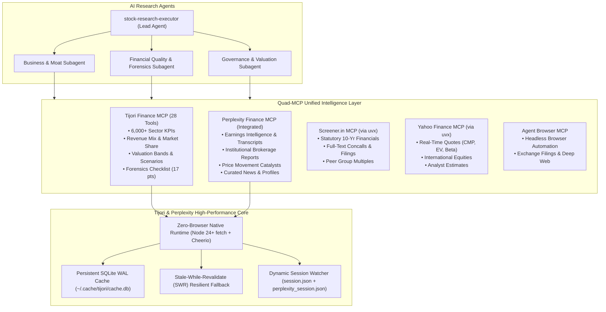

# Architecture & System Design — Quad-MCP Equity Research Engine

This document provides architectural standards, data flows, and design decisions for the **Quad-MCP Equity Research Engine** and the underlying **Tijori & Perplexity Finance MCP Server**.

---

## 1. System Overview

The project has evolved from a single-site scraper into an **enterprise-grade equity research platform and autonomous multi-agent research engine** for AI agents (Antigravity, Claude Code, Cursor, OpenCode).



---

## 2. The Zero-Browser Core Architecture

Historically, the server launched headless Chromium instances via Playwright for runtime queries. This had high memory overhead (~150MB per instance), slow startup times (2-5s), and process concurrency contention.

The modern architecture uses **zero-browser native execution**:
- **`TijoriClient`**: Uses Node 24+ native `fetch` with Cheerio for HTML parsing and direct REST `/api/` calls. Zero Chromium processes run at query time.
- **`PerplexityClient`**: Direct API transport interacting with Perplexity Finance endpoints (`timeline`, `documents`, `earnings`, `profile`, `news`) with cross-resolution for Indian (`.NS`, `.BO`) and US equities.
- **Dynamic Session Reloading**: Automatically watches `output/session.json` and `output/perplexity_session.json`. Re-authenticating via CLI immediately updates runtime headers without server restarts.
- **SQLite WAL Cache with SWR**: Persistent cache stored at `~/.cache/tijori/cache.db`. Provides millisecond responses, bounded memory, and Stale-While-Revalidate (SWR) fallback to ensure research subagents never fail during transient network drops.

---

## 3. Registered Tool Inventory (28 Tools)

All 28 tools are registered in `src/index.js` using Zod input validation schemas and fail-safe result wrappers:

### 3.1 Corporate Overview & Forensic Quality
| Tool | Mechanism / Endpoint | Description |
|---|---|---|
| `search_company` | GET `/api/v1/ind/company_search/?q=` | Resolves query to company name and slug |
| `resolve_company_ids` | In-line script scraping on `/company/{slug}/` | Resolves slug to numeric `company_id` |
| `get_company_overview` | Cheerio DOM extraction (`.custom_ratio`) | Multiples (PE, PB, EV/EBITDA), ROE/ROCE, and 17-point forensic checklist |
| `get_factors_and_benchmarking` | Cheerio DOM extraction (`#factors-table`) | Factor scores (Valuation, Quality, Growth) and percentile rankings |

### 3.2 Granular Multi-Cycle Financials & Capital Allocation
| Tool | Mechanism / Endpoint | Description |
|---|---|---|
| `get_financials` | Basis-aware DOM parser (`consolidated`/`standalone`) | 10-year annual and 10-quarter statements (PL, BS, Cash Flow, Ratios) |
| `get_shareholding` | 10-quarter shareholding parser | Promoter %, FII %, DII %, Public %; `detailed: true` gives line-item mutual funds & retail tiers |
| `get_fund_flow` | GET `/api/v1/ind/fund_flow_analysis_data/{id}/` | Cumulative sources vs uses of cash over 1, 3, 5, 7, or 10-year horizons |
| `get_corporate_actions` | Cheerio DOM extraction | Historical dividend payouts, bonus issues, stock splits, and rights offerings |

### 3.3 Micro-Operational KPIs & Competitive Moats
| Tool | Mechanism / Endpoint | Description |
|---|---|---|
| `get_operational_metrics` | GET `/api/v1/ind/company_op_metrics/{id}/{sectorId}/` | 6,000+ sector-specific unit KPIs (capacity, volumes, realizations, ARPOB, PLF) |
| `get_revenue_mix` | Scraped product & geography tables | Multi-year percentage revenue breakdown by product line and export region |
| `get_market_share` | DOM extraction on `/company/{slug}/` | Segment-specific market share percentages and competitor concentration |
| `get_supply_chain` | Cheerio DOM extraction | Relational product matrix, supplier dependencies, customer concentration |

### 3.4 Valuation Percentile Bands & Forward Models
| Tool | Mechanism / Endpoint | Description |
|---|---|---|
| `get_valuation_bands` | Daily historical P/E time series extraction | 1Y, 3Y, 5Y, and 10Y P/E statistical percentile bands (min, p25, median, p75, max) |
| `get_scenario_projections` | Cheerio DOM forecast table parser | Probabilistic Base, Bear, and Bull 5-year financial scenarios with odds and catalysts |

### 3.5 Macro, Commodities & Sector Themes
| Tool | Mechanism / Endpoint | Description |
|---|---|---|
| `get_raw_materials` | Scraped `/raw-materials` dashboard | Chemicals, metals, and petrochemical spread price trends |
| `get_macro_indicators` | Scraped `/macro` dashboard | Benchmark indicators (credit growth, IIP, GST collections, inflation) |
| `get_markets` | Scraped `/markets` dashboard | Performance of headline indices, niche thematic baskets, and conglomerates |
| `get_sector_constituents` | Query by `tjiid` | Constituent companies of thematic niche sector indices |
| `get_conglomerate_constituents`| Query by `tjiid` | Group companies for major Indian conglomerates (Tata, Birla, Adani, etc.) |

### 3.6 Primary Documents & Real-Time News
| Tool | Mechanism / Endpoint | Description |
|---|---|---|
| `get_knowledge_base` | Document catalog on `/company/{slug}/reports/` | Direct URLs for Annual Reports, Concall Transcripts, and Investor Presentations |
| `fetch_document` | Streamed authenticated HTTP fetch + `pdf-parse` | Full-text extraction from investor PDFs directly into agent context |
| `get_company_timeline` | Cheerio DOM timeline parser | Chronological milestone history and analyst "What to watch" guidance |
| `get_stock_news` | Google News RSS aggregator | Recent financial media headlines and publisher articles |

### 3.7 Screener & Query Engine
| Tool | Mechanism / Endpoint | Description |
|---|---|---|
| `screen_companies` | GET `/api/filter_queries/advanced_search/` | Multi-parameter screening combining financial and alternate business filters |
| `list_popular_screens` | Scraped `/filter/popular-queries/` | Pre-built institutional and value query templates |
| `search_screener_fields` | GET `/api/filter_queries/filter_field_search/` | Full 3,308-entry metric and business entity catalog search |
| `clear_cache` | SQLite cache manager | Selective slug purge or complete cache reset |
| `get_user_info` | Scraped `/account/subscription/` | Subscription tier and session validation status |

### 3.8 Perplexity Finance Intelligence
| Tool | Mechanism / Endpoint | Description |
|---|---|---|
| `get_earnings_intelligence`| Perplexity `/earnings` endpoint | Consensus surprise (revenue & EPS), AI highlights, and diarized transcripts |
| `get_brokerage_reports` | Perplexity `/documents` endpoint | Institutional research reports with bullish/neutral/bearish outlooks and PDFs |
| `get_price_movement_catalysts` | Perplexity `/timeline` endpoint | Historical price catalysts, causal explanations, and source links |
| `get_company_strategic_profile`| Perplexity `/profile` endpoint | Core corporate identity, live valuation multiples, and strategic positioning |
| `get_curated_news` | Perplexity `/news` endpoint | Curated financial publisher commentary and media sentiment |

---

## 4. Multi-Agent Research Orchestration (`stock-research-executor`)

The MCP server is consumed by the **`stock-research-executor`** skill, which implements an 8-phase institutional investment due diligence workflow:

```
Phase 1: Company Ground Truth & Scale Calibration (CMP, MCap, Reporting Basis)
Phase 2: Industry Dynamics, Life Cycle & Competitive Structure
Phase 3: Granular Business Disaggregation (Product & Geo Revenue Mix, Moat Radar)
Phase 4: Multi-Cycle Financial Statement Quality & Forensics (17-point audit)
Phase 5: Governance, Shareholding & Fund Allocation (10-Quarter Trends)
Phase 6: Market Sentiment, Consensus Divergence & Catalysts
Phase 7: Valuation Percentile Bands, Probabilistic Scenarios & Downside Margin
Phase 8: Autonomous Dossier Synthesis & Evidence Verification
```

### Strict Research Guardrails
1. **Fail-Closed Verification**: Every claim must be grounded in primary tool output; ungrounded metrics are rejected.
2. **Unit & Currency Locking**: INR Crores, Lakhs, USD Millions, and Billions are explicitly normalized to prevent 10x/100x scale errors.
3. **Observation Timestamps**: Data points must cite the specific fiscal period (e.g. `FY25Q3`, `FY24 Annual`) rather than vague "current" claims.
4. **Separation of Consensus vs Actual**: Management guidance and broker targets are strictly differentiated from reported statutory financials.

---

## 5. Security, Session & Environment Governance

- **Zero Secrets in Code**: No API keys, passwords, or personal filesystem paths are committed to git.
- **Secure File Permissions**: Sessions stored in `output/session.json` and `output/perplexity_session.json` are written with `0o600` permissions.
- **Standardized PATH & Isolation**: Plugin configurations utilize standard POSIX system PATHs without user-specific paths.
